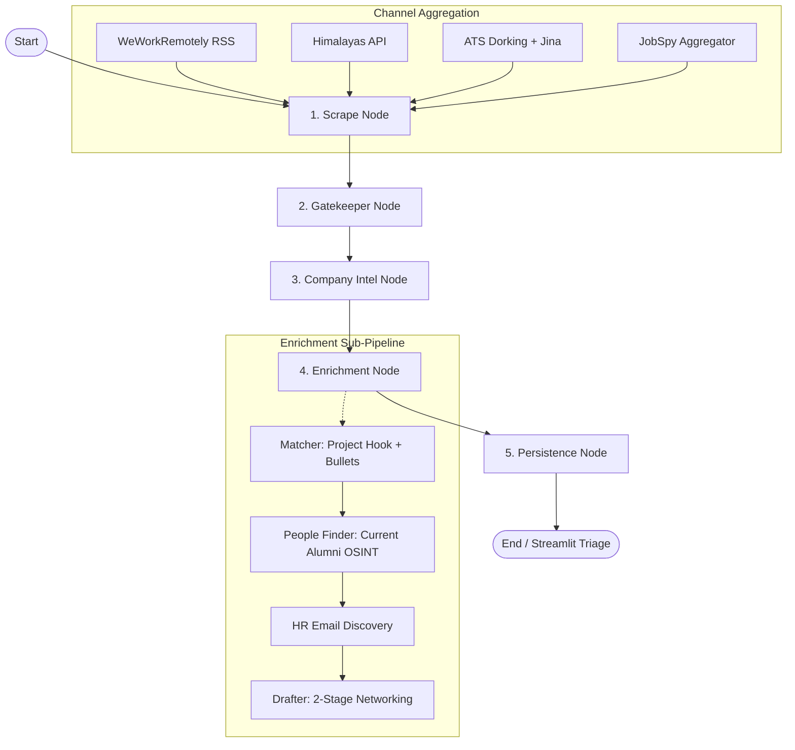
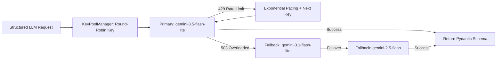

# System Architecture & Technical Deep Dive

This document details the engineering decisions, state machines, database design, and resilient routing mechanisms behind **JobHunt OS**.

---

## 1. The LangGraph Directed Acyclic Graph (DAG)

The orchestration layer is built using **LangGraph** (`StateGraph`) to guarantee deterministic execution, state immutability, and fault isolation across asynchronous operations.



### State Flow (`JobHuntGraphState`)

The graph passes an immutable TypedDict state between nodes:

```python
class JobHuntGraphState(TypedDict, total=False):
    raw_jobs: Annotated[List[JobPosting], operator.add]
    filtered_jobs: List[JobPosting]
    company_intel_pairs: List[Tuple[JobPosting, CompanyIntel]]
    enriched_jobs: Annotated[List[EnrichedJobRecord], operator.add]
```

1. **`scrape_node`**:
   - Concurrently executes the 4 ingestion channels.
   - For ATS dorking links (Greenhouse, Lever, Ashby), calls Jina Reader (`https://r.jina.ai/{url}`) with `ThreadPoolExecutor(max_workers=8)` to hydrate full Markdown JDs in parallel.
   - Normalizes raw outputs into `JobPosting` schemas with a deterministic MD5 hash `job_id = md5(company:role:source)`.

2. **`gatekeeper_node`**:
   - Zero-LLM cost deterministic filter.
   - Executes 7 strict gates in order:
     1. **Seen Filter:** Checks SQLite `(job_id)` or `(company + role)`.
     2. **RLHF / Contract Trap Filter:** Regex detection for prompt rating, AI trainer gigs, and hourly tasks.
     3. **Blacklist Gate:** Drops staffing agencies and talent brokerages.
     4. **Seniority Title Gate:** Drops Staff, Principal, Lead, Senior Manager titles.
     5. **Extracted YoE Gate:** Regex parses `r"(\d+)\+?\s*(?:to\s*(\d+))?\s*(?:years?|yrs?)"` and enforces candidate cap (max 2 YoE).
     6. **Geo-Location Gate:** Verifies India or Global Remote friendliness.
     7. **Sanity Check:** Rejects missing roles or generic URLs.

3. **`company_intel_node`**:
   - Cleans noisy scraper company strings (e.g. `Talentskeet • Bangalore Urban` -> `Talentskeet`).
   - Immediately drops generic placeholders (`confidential`, `stealth`, `startup`) without spending LLM tokens.
   - Checks SQLite `company_cache` table first. On miss, concurrently fetches search snippets.
   - Batches up to 8 uncached companies in a single structured Gemini call, saving results to SQLite cache.

4. **`enrichment_node`**:
   - Caps processing to the top 15 highest-signal jobs to respect daily rate limits.
   - **Matcher:** Analyzes candidate project arsenal (`config/profile_context.yaml`), selects the single best-fit project, drafts a plain-English hook, and generates 2 copy-pasteable first-person resume bullets.
   - **People Finder:** Executes ranked Google dorking queries (BITS Pilani Alumni → Team Engineers → Technical Recruiters) while strictly filtering out ex-employees.
   - **HR Email Finder:** Checks JD text for explicit recruiter emails, dorks careers email snippets, and falls back to clean domain patterns (`careers@{domain}`).
   - **Drafter:** Constructs the two-stage human networking messages.

5. **`persistence_node`**:
   - Atomically commits all `EnrichedJobRecord` instances into the SQLite `jobs` table using `INSERT OR REPLACE` while preserving any manual candidate notes or status transitions.

---

## 2. Multi-Account Key Pool & Resilient LLM Routing

API quota management is a common failure point for autonomous agents. **JobHunt OS** implements a dedicated `KeyPoolManager` in `src/llm_router.py`.



### Key Engineering Features:
- **Round-Robin Rotation:** Cycles multiple Google AI Studio keys parsed from `GEMINI_API_KEYS=key1,key2,key3`.
- **Fast Timeout & Retry Control:** `ChatGoogleGenerativeAI` is instantiated with `timeout=20` and `max_retries=1`. It never hangs in internal Google SDK retry loops during high server demand.
- **503 / High-Demand Failover:** Server errors (`503 Service Unavailable`, `RESOURCE_EXHAUSTED`) immediately trigger an automatic model-switch to the next tier in the chain:
  - `LITE_TIER_MODELS`: `["gemini-3.5-flash-lite", "gemini-3.1-flash-lite", "gemini-2.5-flash-lite", "gemini-2.5-flash"]`
  - `SMART_TIER_MODELS`: `["gemini-3-flash-preview", "gemini-2.5-flash", "gemini-3.5-flash-lite"]`

---

## 3. Database Architecture: Why SQLite?

Rather than introducing heavy cloud databases (e.g. PostgreSQL, Pinecone, or Redis), JobHunt OS relies on a localized, WAL-mode **SQLite** database (`data/job_hunt.db`).

### Design Advantages:
- **Zero Infrastructure Friction:** Runs locally without Docker containers, background daemon services, or network latency.
- **ACID Compliance & Concurrency:** Handles parallel reads and writes with instant file locking and transactions.
- **In-Memory Pandas Integration:** `pd.read_sql_query` reads directly into Streamlit's `st.data_editor` in milliseconds.
- **State Preservation:** Candidate edits (notes, custom recruiter emails, manual stage updates) are preserved even when the daily ingestion pipeline re-runs.

### Schema Design (`jobs` Table):

| Column | Type | Description |
|---|---|---|
| `job_id` | `TEXT PRIMARY KEY` | Deterministic MD5 hash of `company:role:source` |
| `company` | `TEXT NOT NULL` | Cleaned company name |
| `role` | `TEXT NOT NULL` | Exact job title |
| `location` | `TEXT` | Location or remote status |
| `job_url` | `TEXT NOT NULL` | Direct application URL |
| `match_score` | `INTEGER` | 0–100 alignment score |
| `est_ctc_lpa` | `REAL` | Estimated entry CTC in LPA |
| `company_summary` | `TEXT` | 3–4 sentence plain-English overview |
| `winning_hook` | `TEXT` | Specific project-to-JD alignment proof |
| `selected_project`| `TEXT` | ID of the matched arsenal project |
| `jd_summary_json` | `TEXT` | 4–5 bullet points of core role requirements |
| `hr_email` | `TEXT` | Discovered or patterned recruiter email |
| `referrer_name` | `TEXT` | Comma-separated names of discovered contacts |
| `contacts_json` | `TEXT` | Serialized `List[ContactPerson]` |
| `outreach_drafts_json` | `TEXT` | Serialized `List[OutreachPackage]` |
| `status` | `TEXT` | Pipeline stage (`NEW`, `CONNECT_SENT`, etc.) |
| `outreach_sent_at` | `TIMESTAMP` | When connection or referral was initiated |
| `created_at` | `TIMESTAMP` | Record ingestion timestamp |

---

## 4. Two-Stage Human Networking Engine

Most cold outreach tools generate aggressive, immediate referral pitches that fail because asking a stranger for a job referral on first contact feels transactional and disrespectful.

**JobHunt OS implements a realistic 2-stage networking funnel:**

### Stage 1: Connection Request Note (≤ 260 chars)
- **Modal:** Sent inside the LinkedIn "Add a note" connection modal.
- **Frame:** Mentor & advice seeking.
- **Rule:** **Zero referral ask, zero resume metric pitch.**
- **Context:** References shared BITS Pilani university background, grad batch, and the contact's engineering domain.
- *Example:*
  > *"Hi Sonali, fellow BITSian here (2027 batch). Came across your profile while looking into NetApp's AI work. Would love to connect and learn a bit about your engineering journey from BITS to NetApp!"*

### Stage 2: Post-Connection DM (≤ 95 words)
- **Modal:** Sent inside LinkedIn Direct Message **after** they accept the connection.
- **Frame:** Plain-English proof + low-friction referral request.
- **Rule:** Plain, humble English without academic jargon.
- **Friction Reducer:** Explicitly offers to send Resume PDF and Job ID so the referral requires zero effort from the referrer.
- *Example:*
  > *"Hi Sonali, thank you for connecting! I am applying for the AI Engineer position at NetApp. I published an open-source PyPI tool that automatically tracks and debugs why multi-agent LangGraph workflows fail, directly matching NetApp's agent reliability requirements. If you feel my profile is a fit, I'd be really grateful for a referral—happy to send my resume PDF and Job ID so it takes zero hassle. Either way, I'd love any advice you have for a junior entering this space! My work: https://parampatel-ai.vercel.app"*
